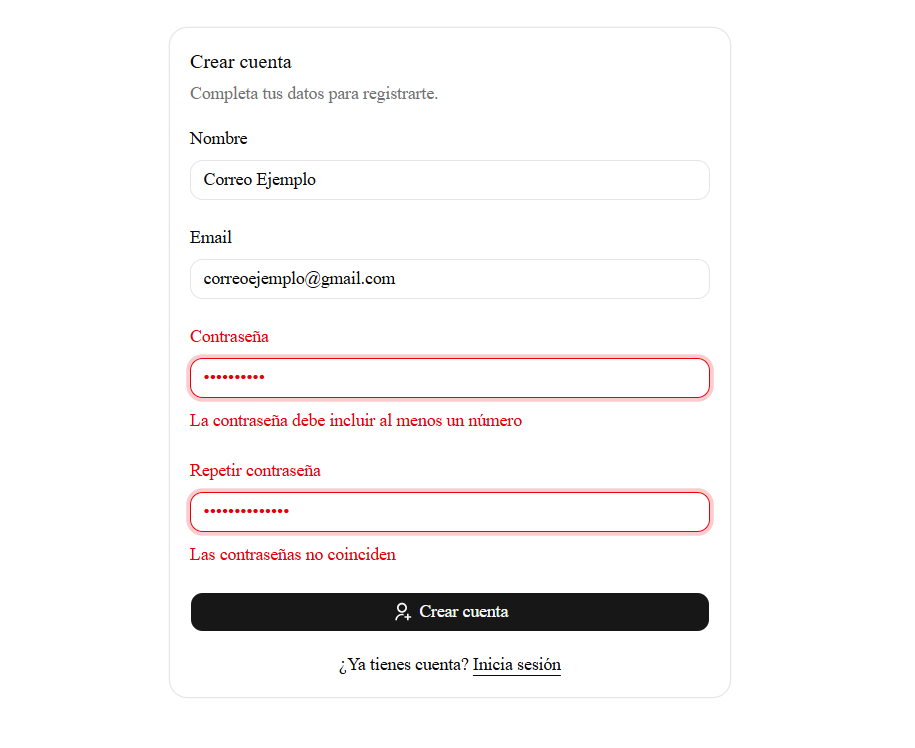
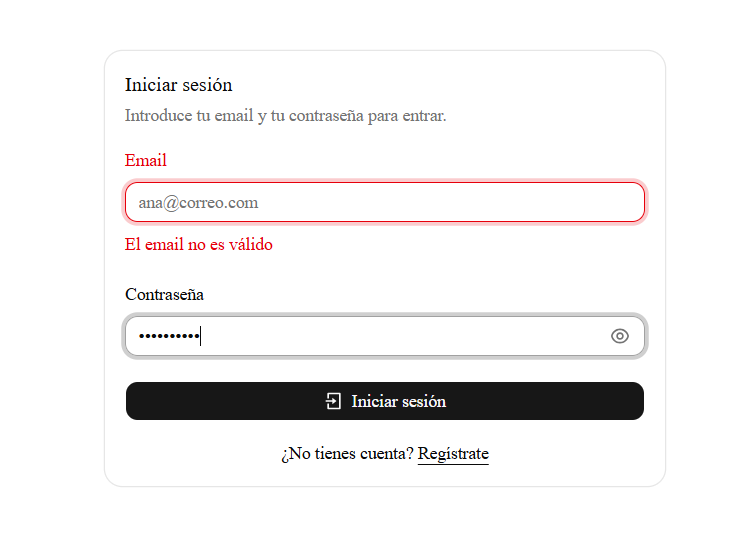
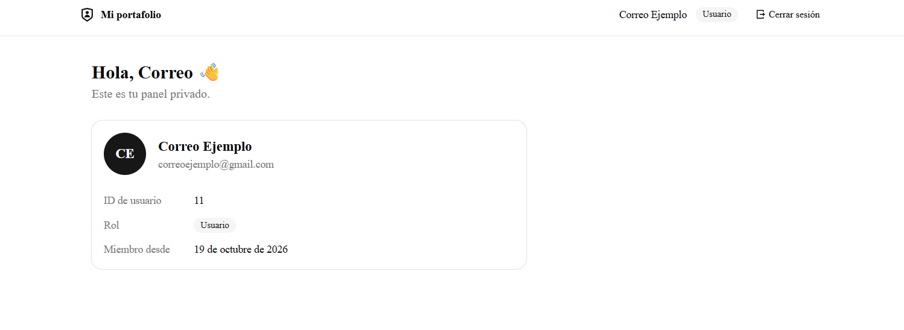
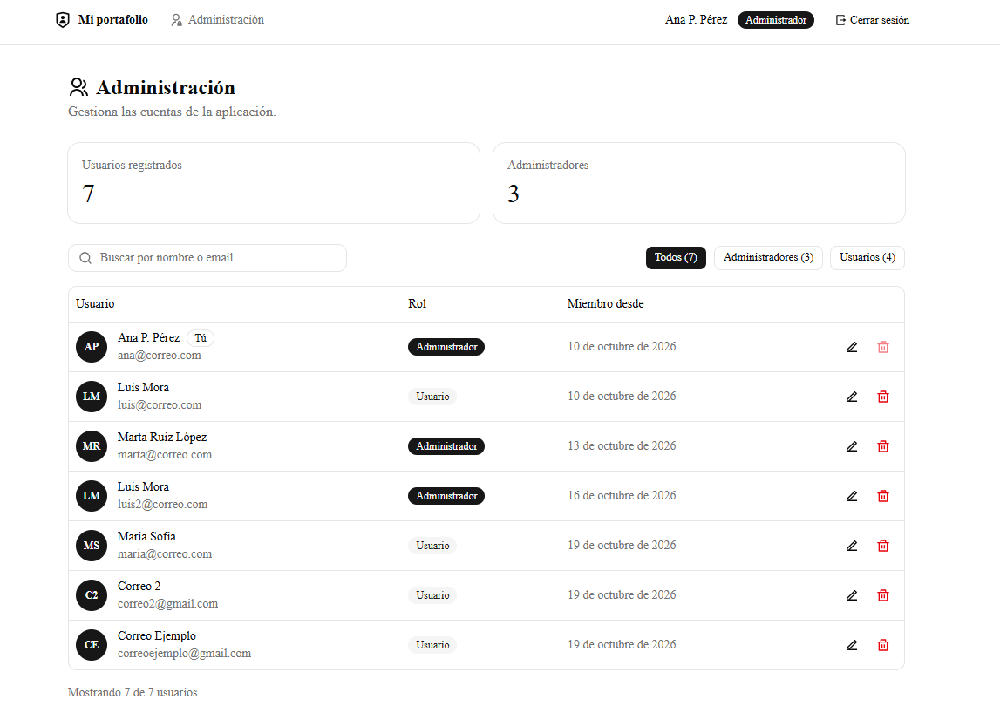
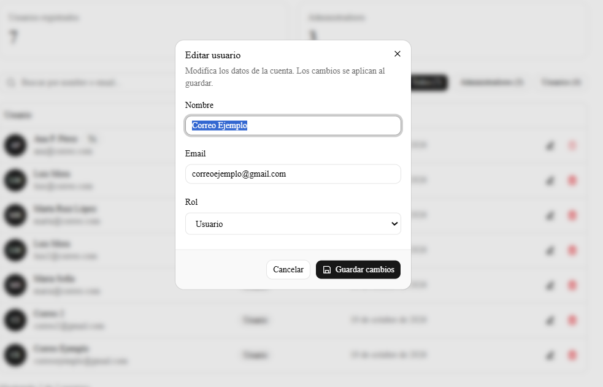

# 🔐 Sistema de autenticación con Next.js, SQLite y JWT

Aplicación web full-stack con **registro, inicio de sesión y gestión de usuarios con roles**. La sesión se mantiene con un **JWT firmado guardado en una cookie `httpOnly`**, y los datos viven en una base de datos **SQLite** que se maneja con **SQL puro**, sin ORM.

> Proyecto de portafolio con un objetivo doble: que funcione de verdad y entender cada pieza por dentro (hashing, JWT, cookies, autorización, validación). Las secciones de [decisiones de diseño](#-decisiones-de-diseño) y [limitaciones](#️-limitaciones-conocidas) explican el porqué de cada elección.


**Demo en línea:** _pendiente de despliegue_

## 📸 Capturas

| Registro con validación | Login con error |
|:--:|:--:|
|  |  |

| Panel del usuario | Administración de usuarios |
|:--:|:--:|
|  |  |

| Edición de un usuario |
|:--:|
|  |

## ✨ Características

- **Registro** con validación en el cliente y en el servidor (el mismo esquema Zod en ambos lados).
- **Inicio y cierre de sesión** con JWT en cookie `httpOnly`, y aviso del motivo al volver al login (sesión cerrada o caducada).
- **Rutas protegidas** en dos capas: un `proxy` rápido y una comprobación en cada página y API contra la base de datos.
- **Roles** `user` y `admin`, con el rol leído de la base de datos en cada petición (un cambio de rol surte efecto al instante).
- **Panel de administración**: tabla con búsqueda sin acentos ni mayúsculas, filtro por rol, **edición** y **eliminación** de usuarios.
- **Reglas de negocio**: no puedes eliminar tu propia cuenta, ni cambiar tu propio rol, ni dejar el sistema sin administradores.
- **Límite de intentos** de login (por email y por IP) y de registro (por IP).
- **Formularios accesibles**: etiquetas enlazadas, errores anunciados a lectores de pantalla y botón para mostrar u ocultar la contraseña.
- **Endpoint de salud** (`/api/health`) para monitoreo.

## 🧰 Stack tecnológico

| Tecnología | Para qué se usa | Por qué |
|---|---|---|
| **Next.js 16** (App Router) | Páginas, rutas de API y protección de rutas en un solo proyecto | Estándar actual de React en el servidor |
| **React 19 + TypeScript** | Interfaz con tipos | Errores detectados antes de ejecutar |
| **SQLite** + `better-sqlite3` | Base de datos en un archivo | SQL real sin infraestructura; API síncrona y rápida |
| **bcryptjs** | Hash de contraseñas | Hash lento con sal; JavaScript puro, sin compilación nativa |
| **jose** | Crear y verificar JWT (HS256) | Funciona en todos los entornos de ejecución de Next.js |
| **Zod 4** | Validación de datos | Un único esquema para cliente y servidor |
| **React Hook Form** | Formularios | Rendimiento y buena integración con Zod |
| **Tailwind CSS + Shadcn UI** | Estilos y componentes | Componentes cuyo código es del proyecto, no de una librería externa |
| **Remixicon** | Iconos | Estilo coherente |

## 🏗️ Arquitectura

```
                    ┌───────────────────────────────────────────┐
                    │                 Next.js                   │
 Navegador ───────► │                                           │
                    │  proxy.ts ── Capa 1 (JWT válido y origen) │
                    │      │                                    │
                    │      ├──► Páginas (Server Components)     │
                    │      │       └─ Capa 2: getCurrentUser()  │
                    │      │          requireAdmin()            │
                    │      │                                    │
                    │      └──► /api/* (Route Handlers)         │
                    │              └─ Zod → lógica → SQLite     │
                    └───────────────────────────────────────────┘
```

**Flujo de autenticación**

1. `POST /api/auth/login` valida los datos con Zod y comprueba la contraseña con bcrypt.
2. Si es correcta, se firma un **JWT** (`sub` = id de usuario, caduca en 7 días) y se entrega en una cookie `httpOnly`, `sameSite=lax` (y `secure` en producción).
3. En cada petición, el navegador envía la cookie. El `proxy` verifica la firma (sin tocar la base de datos). Después, cada página o API vuelve a comprobar **contra la base de datos** que el usuario existe y lee su rol.
4. `POST /api/auth/logout` borra la cookie.

## 🚀 Cómo ejecutarlo en local

**Requisitos:** Node.js **20.9 o superior** (probado con Node 22) y npm. No necesitas compiladores: `better-sqlite3` se instala con un binario precompilado.

```bash
# 1. Clonar e instalar
git clone https://github.com/gustavo93826/Aplicacion-web-de-autenticacion-con-JWT-y-React.git
cd Aplicacion-web-de-autenticacion-con-JWT-y-React
npm install

# 2. Crear el archivo de variables de entorno
cp .env.example .env.local        # en Windows PowerShell: copy .env.example .env.local

# 3. Generar un secreto y pegarlo en AUTH_SECRET (dentro de .env.local)
node -e "console.log(require('crypto').randomBytes(32).toString('hex'))"

# 4. Arrancar
npm run dev
```

Abre <http://localhost:3000>. La base de datos (`data/app.db`) se crea sola en el primer arranque.

### Variables de entorno

| Variable | ¿Obligatoria? | Descripción |
|---|---|---|
| `AUTH_SECRET` | **Sí** | Secreto para firmar los JWT (mínimo 32 caracteres). Cambiarlo cierra todas las sesiones. |
| `DATABASE_PATH` | No | Ruta del archivo SQLite. Por defecto `./data/app.db`. En un servidor debe apuntar a un disco persistente. |

### Crear un administrador

Por seguridad, nadie puede hacerse administrador desde la web. El primero se crea desde la terminal, sobre una cuenta ya registrada:

```bash
node scripts/set-role.mjs tu@correo.com admin
```

Si usas `DATABASE_PATH` en `.env.local`, añade `--env-file=.env.local` después de `node`.

### Scripts

| Comando | Qué hace |
|---|---|
| `npm run dev` | Servidor de desarrollo |
| `npm run build` | Compila para producción |
| `npm run start` | Sirve la versión compilada |
| `npm test` | Compila y ejecuta las pruebas de integración |

### Pruebas automatizadas

`npm test` levanta la aplicación compilada con una base SQLite temporal y verifica tres flujos de la API: registro, inicio de sesión y permisos de administrador. No modifica `data/app.db` ni necesita servicios externos.

## 🧪 Flujo de demostración

1. Regístrate en `/register` (prueba datos inválidos para ver los errores).
2. Inicia sesión en `/login` y entra en el panel (`/dashboard`).
3. Conviértete en administrador con el script anterior y recarga: aparece el enlace **Administración**.
4. En `/admin`, busca, filtra, edita y elimina usuarios de prueba.
5. Comprueba las reglas: no puedes eliminarte, ni cambiar tu rol, ni quitar el rol al último administrador.
6. Haz varios intentos fallidos de login seguidos y observa el bloqueo temporal (429).

## 🗂️ Estructura del proyecto

```
├── proxy.ts                  Capa 1: sesión válida y filtro de origen (CSRF)
├── next.config.ts            Cabeceras de seguridad
├── scripts/set-role.mjs      Herramienta de administración (terminal)
├── app/
│   ├── login/, register/     Formularios públicos
│   ├── dashboard/            Zona privada
│   ├── admin/                Zona solo para administradores
│   ├── access-denied/        Pantalla de acceso denegado
│   └── api/
│       ├── auth/             register, login, me, logout
│       ├── users/            listar, editar y eliminar
│       └── health/           chequeo de salud
├── components/
│   ├── auth/                 LoginForm, RegisterForm, LogoutButton
│   ├── admin/                UsersTable, EditUserDialog, DeleteUserDialog
│   ├── layout/               AppHeader
│   └── ui/                   Componentes de Shadcn UI
└── lib/
    ├── db.ts                 Conexión SQLite y esquema
    ├── auth.ts               Crear y verificar JWT
    ├── session.ts            Cookies de sesión y getCurrentUser()
    ├── authz.ts              requireAdmin() y requireAdminApi()
    ├── users.ts              Consultas y reglas de negocio (transacciones)
    ├── password.ts           Hash y verificación con bcrypt
    ├── rate-limit.ts         Límite de intentos
    ├── request.ts            IP del cliente y comprobación de origen
    └── validations/          Esquemas Zod compartidos
```

## 🌐 Rutas y API

**Páginas**

| Ruta | Acceso |
|---|---|
| `/` | Pública |
| `/register`, `/login` | Públicas (redirigen al panel si ya hay sesión) |
| `/dashboard` | Requiere sesión |
| `/admin` | Solo administradores |
| `/access-denied` | Pública |

**API**

| Método y ruta | Acceso | Respuestas |
|---|---|---|
| `POST /api/auth/register` | Pública | 201, 400, 409, 429 |
| `POST /api/auth/login` | Pública | 200, 400, 401, 429 |
| `GET /api/auth/me` | Sesión | 200, 401 |
| `POST /api/auth/logout` | Pública | 200 |
| `GET /api/users` | Admin | 200, 401, 403 |
| `PATCH /api/users/:id` | Admin | 200, 400, 401, 403, 404, 409 |
| `DELETE /api/users/:id` | Admin | 200, 400, 401, 403, 404, 409 |
| `GET /api/health` | Pública | 200, 503 |

## 🔒 Seguridad

| Medida | Dónde |
|---|---|
| Contraseñas con **bcrypt** (sal y coste 10); se rechazan las de más de 72 bytes | `lib/password.ts` |
| **JWT firmado (HS256)** con caducidad; se fija el algoritmo permitido al verificar | `lib/auth.ts` |
| Cookie **`httpOnly`**, **`sameSite=lax`** y **`secure`** en producción | `lib/session.ts` |
| Validación de **toda** entrada con Zod; los campos desconocidos se descartan (sin *mass assignment*) | `lib/validations/` |
| **SQL parametrizado** en todas las consultas | `lib/*.ts` |
| Mensaje **único** de error de login y **mismo tiempo de respuesta** (hash ficticio) | `api/auth/login` |
| **Límite de intentos** por email y por IP (429 con `Retry-After`) | `lib/rate-limit.ts` |
| **Filtro de origen** anti-CSRF en las APIs que modifican datos | `proxy.ts` |
| Autorización en **cada página y API**, con el rol leído de la base de datos | `lib/authz.ts` |
| **Transacciones** en operaciones críticas (último administrador) | `lib/users.ts` |
| Nunca se devuelve `password_hash` | Tipo `PublicUser` y columnas explícitas |
| Motivos de redirección con **lista blanca** (sin texto controlado por la URL) | `lib/login-reasons.ts` |
| **Cabeceras de seguridad** (`nosniff`, `frame-ancestors`, `Referrer-Policy`, HSTS en producción...) | `next.config.ts` |
| Secretos en variables de entorno, fuera de Git | `.env.local`, `.gitignore` |

## 🧠 Decisiones de diseño

| Decisión | Motivo |
|---|---|
| **JWT en cookie `httpOnly`, no en `localStorage`** | El JavaScript de la página no puede leer la cookie, lo que limita el daño de un XSS. |
| **El rol no va dentro del JWT** | Un cambio de rol o la eliminación de un usuario surte efecto de inmediato, sin esperar a que caduque el token. |
| **El token solo lleva el `id`** | Cambiar el nombre o el email no invalida la sesión. |
| **SQL puro con `better-sqlite3`, sin ORM** | Hace visible lo que ocurre por debajo y facilita razonar sobre transacciones y restricciones. |
| **Dos capas de protección** | El `proxy` es rápido pero no consulta la base de datos; la comprobación real vive en cada página y API. Un layout por sí solo no es una barrera fiable. |
| **La redirección "ya tienes sesión" vive en las páginas, no en el proxy** | Evita un bucle infinito si el token es válido pero el usuario fue eliminado. |
| **Capa de datos separada de las rutas** (`lib/users.ts`) | Las rutas hablan HTTP; la capa de datos aplica las reglas y devuelve resultados, no códigos de estado. |
| **El primer administrador se crea por terminal** | Resuelve el problema del "huevo y la gallina" sin abrir un camino de escalada de privilegios desde la web. |

## ⚠️ Limitaciones conocidas

- **Los JWT no se pueden revocar** antes de caducar. Se compensa con caducidad de 7 días y comprobando la base de datos en cada petición, pero un token robado seguiría siendo válido hasta entonces.
- **El límite de intentos vive en memoria**: se reinicia con el servidor y no se comparte entre varias instancias.
- **La IP del cliente sale de `X-Forwarded-For`**, que se puede falsear si el servidor no está detrás de un proxy de confianza. El límite por email sigue protegiendo cada cuenta.
- **El mensaje "ya existe una cuenta con ese email"** del registro permite saber qué emails están registrados (compromiso entre seguridad y claridad).
- **Sin verificación de email, recuperación de contraseña ni 2FA.**
- **CSP parcial**: solo las directivas que no afectan a los scripts. Una CSP estricta exigiría *nonces*.
- **SQLite necesita un disco persistente y una sola instancia** (ver [Despliegue](#️-despliegue)).
- **Las pruebas automatizadas cubren los flujos principales de la API**; todavía no hay pruebas de interfaz ni cobertura completa de todas las reglas de negocio.
-- **`better-sqlite3` está fijado en la 12.11.1** por un fallo de instalación de la 13.x en Windows. Se revisará cuando se corrija en una versión posterior.

## 📦 Seguridad de dependencias

- `npm audit --omit=dev` (dependencias de producción) no reporta vulnerabilidades.
- El `npm audit` completo muestra avisos de gravedad alta en `braces`, que llega a través de `eslint-config-next` (**solo herramientas de desarrollo**). A fecha de octubre de 2026 no existe una versión corregida de `braces`, y ese código no se ejecuta en el servidor. Se revisará de nuevo cuando haya una versión parcheada.
- La dependencia `shadcn` se eliminó del proyecto con `npx shadcn@latest eject`, que copia al CSS propio el único fragmento que se usaba en tiempo de ejecución.

Revisión periódica:

```bash
npm audit --omit=dev
npm outdated
```

## ☁️ Despliegue

SQLite guarda los datos en **un archivo**, así que la aplicación necesita:

- Un servidor con **disco persistente** (si el disco es efímero, los usuarios se pierden en cada reinicio).
- **Una sola instancia** de la aplicación (varias instancias no deben escribir en el mismo archivo).
- Variables de entorno `AUTH_SECRET` y, si procede, `DATABASE_PATH` apuntando al disco persistente.
- **HTTPS**, necesario para que la cookie `secure` funcione y para HSTS.
- Un proxy inverso de confianza que establezca `X-Forwarded-For` y `X-Forwarded-Host`.

> No es adecuado para plataformas *serverless* sin disco persistente.

## 🛣️ Siguientes pasos

- [ ] Pruebas automáticas (reglas de negocio, rutas de API).
- [ ] Revocación de sesiones guardándolas en la base de datos.
- [ ] Límite de intentos persistente.
- [ ] Verificación de email y recuperación de contraseña.
- [ ] Autenticación en dos pasos (2FA).
- [ ] CSP estricta con *nonces*.
- [ ] Prefijo `__Host-` en el nombre de la cookie en producción.

## 📚 Lo que aprendí

- Cómo se relacionan **autenticación** (quién eres) y **autorización** (qué puedes hacer).
- Qué contiene realmente un **JWT** y por qué la firma no equivale a cifrado.
- Por qué la validación del servidor es la que cuenta y la del formulario es una cortesía.
- Cómo **dos capas de protección** evitan depender de una sola barrera.
- Que un aviso de seguridad (`npm audit`) es una pista que hay que evaluar, no un veredicto.


## 🩺 Solución de problemas

**Windows: `gyp ERR! find VS` o `Could not find any Visual Studio installation` al hacer `npm install`**

Es un fallo conocido de `better-sqlite3` 13.x en Windows: npm intenta compilarlo en lugar de usar el binario incluido. Por eso este proyecto fija `better-sqlite3` en la versión exacta **12.11.1**, que descarga un binario precompilado. No cambies esa versión. Si el error persiste, comprueba que tu red permite descargar desde `github.com`.

## 👤 Autor

**[Gustavo Hernandez Mejia]** · [LinkedIn](https://www.linkedin.com/in/gustavo-hernandez-mejia-122b8936a) · [GitHub](https://github.com/gustavo93826)